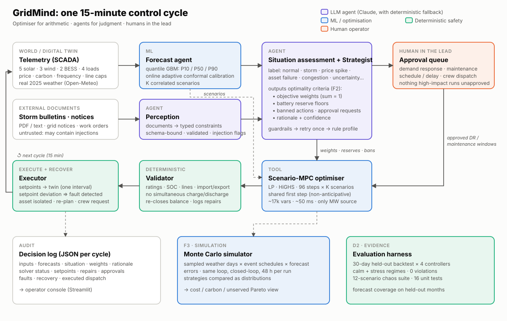

# GridMind architecture

## Design principle

**The optimiser does the arithmetic, the agents supply judgment, and humans stay in the lead.**

Large language models are unreliable at constrained numerical optimisation. A single infeasible action, such as discharging an empty battery, is unacceptable in grid operations. GridMind therefore divides the work as follows:

| Concern | Owner | Why |
|---|---|---|
| *What* to optimise for in this situation (weights, reserves, bans) | **Strategist agent** (Claude; rule profiles as fallback) | This is a judgment call that depends on the situation. It is the F2 requirement. |
| Turning messy documents into constraints | **Perception agent** (Claude; deterministic parser as fallback) | Bulletins, notices and work orders are unstructured. |
| Probabilistic forecasts | **Forecast agent** (quantile gradient boosting plus online conformal calibration) | Uncertainty has to be quantified, not guessed. |
| *How*: the MW setpoint for every asset | **Scenario-MPC optimiser** (an LP solved by HiGHS) | It is provably optimal for the stated objective and always respects physics. |
| Physics and safety | **Validator** (deterministic) | Nothing reaches an asset without passing it. |
| High-impact actions | **Human approval queue** | Demand response, maintenance changes and crew dispatch are the operator's call. |

The LLM never outputs a megawatt value.

## One control cycle (15 minutes): `Orchestrator.tick()`

1. **Perceive.** Read telemetry. Readings lost to sensor dropout are replaced with last-known-good values and flagged. Documents in the inbox are converted to typed constraints such as `storm_alert`, `line_limit`, `maintenance_request`, `demand_change`, `generation_derate`, `asset_outage` and `price_alert`. Each one is validated: the asset must exist, the time window must be sane, and values must be in range. Instruction-like text is flagged and ignored.
2. **Forecast.** Produce P10/P50/P90 for 5 solar parks, 3 wind farms, demand and price over a 24-hour horizon. The bands are recalibrated online from realised coverage using adaptive conformal inference, and K correlated scenarios are sampled from them.
3. **Assess.** Compute situation features (price outlook, renewable versus demand outlook, uncertainty, state of charge, outages, faults, line limits, grid frequency, alerts) and assign a label from: `normal`, `renewable_surplus`, `price_spike`, `congestion`, `high_uncertainty`, `grid_stress`, `asset_failure` or `storm`.
4. **Strategise.** The Strategist returns a `StrategyDecision` containing:
   - the weights,
   - battery reserve floors,
   - banned actions,
   - human-approval requests,
   - a rationale,
   - a confidence score.

   The guardrails require that weights lie in [0, 1] and sum to 1, that reliability is at least 0.05, that reserves lie between 0% and 60%, and that battery IDs exist. A decision that fails is retried once, and then the deterministic profile is used. The LLM is consulted only when the situation materially changes, which keeps cost and latency down.
5. **Human gate.** Requests go to the approval queue. Only approved demand response (MW within a time window) and approved maintenance windows become available to the optimiser.
6. **Optimise.** A linear program over 96 steps × K scenarios, solved with HiGHS. Its components:
   - **Variables:** renewable use and curtailment, battery charge, discharge and SOC, import and export, demand response, deferral and advance of industrial load, a load-shift balance, and unserved energy.
   - **Constraints:** energy balance; SOC dynamics with efficiencies; power ratings; soft reserve floors; corridor capacity, which can vary per step; import and export limits; battery headroom for frequency response; and energy-neutral load shifting with a bounded running balance.
   - **Objective:** a weighted sum of energy cost, carbon (at a shadow price), curtailment, degradation, reliability (VOLL), demand-response incentives and terminal SOC value.
   - **Non-anticipativity:** step 0 is shared by all scenarios, so only one decision is executed.
7. **Validate.** Setpoints are clipped to physical limits, overlapping charge and discharge are netted, demand response is limited to what was approved, and the energy balance is re-closed on the nowcast. Every repair is logged.
8. **Execute and recover.** The twin applies the setpoints. A battery that does not follow its setpoint is detected as faulty in the same interval. It is isolated, the next cycle re-plans without it, and a crew request goes to the operator. Once approved, the crew repairs it in about 2 hours.
9. **Log.** One JSON record per cycle (see [logs/sample_demo_day.jsonl](logs/sample_demo_day.jsonl)).

## Model usage

| Component | Model | Notes |
|---|---|---|
| Strategist | `claude-opus-5-5` via `client.beta.messages.parse` with a Pydantic `output_format` | Low effort; server-side refusal fallback (`fallbacks="default"`); disk cache keyed by request hash; replay mode for deterministic demos. |
| Perception | `claude-opus-5-5`, structured output | PDFs are sent as native `document` blocks. The system prompt declares the content to be untrusted data. |
| Forecasting | scikit-learn `HistGradientBoostingRegressor` (quantile loss), 12 models | Trained on Jan–Aug 2025 and calibrated on Sep. Oct–Dec is held out. |
| Optimiser | HiGHS (through `scipy.optimize.linprog`) | About 17,000 variables; 38–50 ms per solve. |

**Offline guarantee.** If no API key is set, or `GRIDMIND_LLM=off`, both agents use their deterministic implementations under the same contract. That is how the evaluation is run, so it is reproducible. The Claude path is covered by tests with a stub client (`tests/test_llm_path.py`).

## Claim → evidence: **F3 / D2**

| Claim | Requirement (Problem 4) | Where to see it in the demo | Where to verify it in the repo |
|---|---|---|---|
| **F1** | Determine the optimal cluster of actions | Control room → *Action cluster* every 15 minutes: charge/discharge/hold per battery, buy/sell, curtail per asset, demand response, load shift, "delay selling until ~19:15" | `gridmind/optimizer.py`, `Orchestrator._describe`, `logs/sample_demo_day.jsonl` |
| **F2** | Determine the optimality criteria for the situation and adjust for uncertainty | The storm bulletin switches the weights (reliability 0.10 → 0.60) and raises reserves (10% → 45%); the price spike, stale forecast and outage each switch the profile. P10–P90 bands feed K-scenario MPC. | `gridmind/strategist.py`, `gridmind/forecast.py`; chaos tests `stale_forecast`, `price_spike`; Monte Carlo: the adaptive strategy dominates every fixed profile |
| **F3** | Simulate the situation over time, accounting for variations in inputs | Simulation tab: 100 sampled worlds × 48 h × 5 strategies, shown as cost distributions and a Pareto view, plus a live what-if | `gridmind/montecarlo.py`, `eval/results/montecarlo_*.csv` |
| **D2** | Mostly structured and textual input, high demonstrable reliability | Evaluation tab: 0 violations in every run; 12/12 chaos tests; 0 unserved energy under stress | `eval/results/backtest_summary.csv`, `chaos.csv`, `forecast_calibration.csv`, `tests/` (22 tests) |
| D3 (not claimed) | Highly heterogeneous multimodal input | PDF bulletins and work orders are read; images and weather maps are not | `gridmind/perception.py` |

**Why D2 and not D3.** Our inputs are time series, text and PDFs. That is "mostly structured and textual". We do not process images, weather maps or audio, so claiming D3 would be overestimation.

## Headline evidence

The reliability results are reported in full in `eval/results/`.

- **Backtest, 30 held-out days, stress regime:**
  - GridMind had **0 MWh** of unserved energy. Deterministic MPC had 41.1 MWh, perfect-forecast MPC 6.1 MWh, and the rule-based EMS 529 MWh.
  - Total cost was **18.1% below the rule-based baseline**, versus 16.0% for deterministic MPC and 17.5% for perfect-forecast MPC.
  - There were **0 constraint violations** across all controllers and both regimes.
- **Backtest, calm regime:**
  - GridMind captures 91% of the perfect-forecast savings. Deterministic MPC captures 92%.
  - In calm weather, adaptivity costs about 0.1%. It pays off under stress.
- **Monte Carlo, 100 runs × 48 h:**
  - GridMind is the **only Pareto-efficient strategy**. It has the lowest mean cost, the lowest CVaR95 cost (₹432 L versus ₹476–690 L), the lowest carbon, and the lowest probability of any unserved energy (4%, versus 8–74%).
- **Forecasts:** P10–P90 coverage on held-out months is **78–83%** against a target of 80% (with online adaptive conformal calibration).
- **Chaos suite:** **12/12 passed.** It covers a battery outage mid-discharge, a silent battery fault followed by crew recovery, line congestion, a price spike, two simultaneous failures, sensor dropout, a stale forecast, malformed LLM output, prompt injection inside a PDF, a storm with advance warning (0 vs 23 MWh unserved compared with MPC), a demand surge, and maintenance planning followed by a storm delay.

## Responsible AI and robustness

- **Hallucination containment.** LLM outputs are schema-bound, pass guardrail checks, carry no numeric dispatch authority, and fall back deterministically.
- **Prompt injection.** Documents are treated as data. The schema has no field that can carry an instruction. A detector flags injection attempts. In the chaos test, the strategy and dispatch were identical for the clean and the poisoned PDF.
- **Human oversight.** Demand response, maintenance scheduling or delay, and crew dispatch require approval. Identical requests are never asked twice.
- **Auditability.** There is one JSON record per decision: inputs, forecasts, situation, weights, rationale, solver status, setpoints, repairs, approvals and faults.
- **Fault tolerance.**
  - Solver failure → the rule-based safe action.
  - LLM outage or refusal → rule profiles.
  - Sensor dropout → last-known-good values.
  - Asset fault → isolate and re-plan.
- **Privacy.** No personal data is used. Only aggregated asset telemetry is sent to the LLM.
- **Data transparency.** See [DATA.md](DATA.md).

## Scalability

- **Solve time grows roughly linearly** with assets × horizon × scenarios. The current problem has about 17,000 variables and solves in about 50 ms, so even 10× more assets fits comfortably within the 15-minute cycle.
- **Agents are called only when the situation changes**, not every tick. With caching, LLM cost per day is bounded by the number of situation changes.
- **Integration path:**
  - Replace `DigitalTwin.telemetry()` and `step()` with SCADA/EMS adapters (IEC 61850 / OPC-UA).
  - Replace the replayed price series with IEX day-ahead and real-time feeds.
  - Keep the validator and the approval queue in front of every write.
