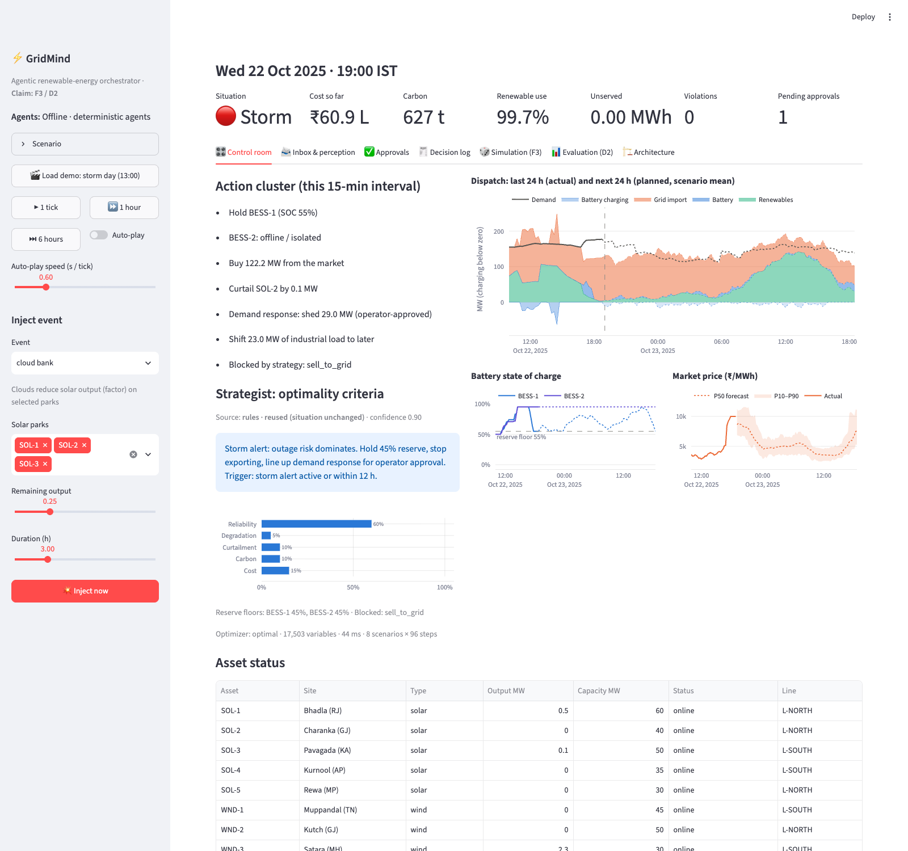

# ⚡ GridMind: an agentic renewable-energy orchestrator

**ET AI Hackathon 2026 (Agentic Edition) · Problem 4: Renewable Energy Orchestrator**
**Self-declared position: F3 / D2** (justified in [ARCHITECTURE.md](ARCHITECTURE.md#claim--evidence-f3--d2))

Every 15 minutes, GridMind decides how to run a portfolio of 5 solar parks, 3 wind farms, 2 batteries and 4 industrial loads, with grid and market access. Its decisions cover charging, discharging or holding storage, buying or selling, curtailing, shifting or shedding load, and scheduling or delaying maintenance. It explains each decision, keeps a human in charge of high-impact actions, and recovers when assets fail.

> **Optimiser for arithmetic. Agents for judgment. Humans in the lead.**
> A Claude-powered *Strategist* chooses the optimality criteria for the current situation: objective weights, reserve floors and banned actions. A scenario-based MPC (an LP solved by HiGHS) turns those criteria into MW setpoints. A deterministic validator and a human approval gate stand between every decision and the assets. **The LLM never outputs a megawatt value.**



## Results (held-out data, reproducible with `make eval`)

<!-- RESULTS:START -->
| 30-day backtest, **stress** regime | Total cost (₹ lakh) | Saving vs rules | Unserved energy | Violations |
|---|---:|---:|---:|---:|
| Rule-based EMS (baseline) | 6,671 | – | 529 MWh | 0 |
| Deterministic MPC (ablation: no agents) | 5,600 | 16.0% | 41 MWh | 0 |
| Perfect-forecast MPC (reference) | 5,501 | 17.5% | 6 MWh | 0 |
| **GridMind** | **5,462** | **18.1%** | **0 MWh** | **0** |

| Monte Carlo, 100 worlds × 48 h | Mean cost | CVaR95 cost | Carbon | P(any unserved) |
|---|---:|---:|---:|---:|
| Rule-based EMS | ₹391 L | ₹690 L | 3,625 t | 74% |
| Cost-first (fixed) | ₹347 L | ₹529 L | 3,653 t | 20% |
| Green-first (fixed) | ₹345 L | ₹515 L | 3,642 t | 10% |
| Resilience-first (fixed) | ₹346 L | ₹476 L | 3,666 t | 8% |
| **GridMind adaptive** | **₹339 L** | **₹432 L** | **3,604 t** | **4%** |
<!-- RESULTS:END -->

- **Situation-aware criteria beat every fixed policy.** GridMind is the only Pareto-efficient strategy on cost, carbon and unserved energy, and it has the best tail risk.
- **Even perfect forecasts are not enough.** Perfect-forecast MPC (6 MWh unserved) and plain MPC (41 MWh) still drop load when batteries fail silently or storms arrive. GridMind reads the warning, holds reserve, lines up demand response for approval, and isolates faulty assets.
- **Being honest about calm weather:** with no events, GridMind captures 91% of the perfect-forecast saving, against 92% for plain MPC. Adaptivity costs about 0.1% on calm days and pays for itself under stress.
- **Chaos suite: 12/12 pass.** It covers a battery outage mid-discharge, a silent fault followed by crew recovery, congestion, a price spike, two simultaneous failures, sensor dropout, a stale forecast, malformed LLM output, **prompt injection inside a PDF**, a storm with advance warning, a demand surge, and maintenance planning followed by a storm delay. See [eval/results/chaos.md](eval/results/chaos.md).
- **Forecasts:** P10–P90 coverage on held-out months is 78–83% against an 80% target, using online adaptive conformal calibration.

## Run it

**One command (Docker):**

```bash
docker compose up --build        # open http://localhost:8501
```

**Local (Python 3.11+):**

```bash
python -m venv .venv && source .venv/bin/activate
make install                     # pinned deps + package
make app                         # operator console at http://localhost:8501
make test                        # 22 tests (optimizer physics, validator, guardrails, perception, LLM path, UI)
make demo                        # the demo storyline, headless -> logs/sample_demo_day.jsonl
make eval                        # forecast calibration + chaos + 30-day backtest + Monte Carlo
```

**Claude (optional).** Copy `.env.example` to `.env` and set `ANTHROPIC_API_KEY`. The Strategist and Perception agents then use `claude-opus-5-5`, with structured outputs, guardrails and a response cache. Without a key, both agents run their deterministic implementations under the same contract, so the evaluation is fully reproducible. `GRIDMIND_LLM=replay` serves only cached Claude responses, which gives deterministic demo recordings.

## Demo in 60 seconds

1. Click **🎬 Load demo: storm day**. Twelve real control cycles run, from 10:00 to 13:00, with a cloud bank passing at 11:00.
2. Open **Inbox**, then **imd_storm_bulletin.pdf**. Perception extracts `storm_alert · SOL-2, WND-2 · 17:00–22:00`. The Strategist switches to *storm*: reliability weight 0.10 → 0.60, reserves 10% → 45%, exports blocked, and a demand-response request is raised.
3. Go to **Approvals** and approve demand response. Run **6 hours**. The batteries pre-charge to 95% before the storm.
4. In the sidebar, choose **Inject event → battery unresponsive** for BESS-2, then **storm**. The fault is detected from the setpoint deviation, BESS-2 is isolated, and a crew request appears.
5. Try **imd_storm_bulletin_injected.pdf**. The injected instructions are flagged and ignored, and the strategy is unchanged.
6. Open **Simulation (F3)** for distributions and the Pareto view, and **Evaluation (D2)** for the backtest, chaos and calibration results.

## How it maps to the problem statement

| Problem statement | GridMind |
|---|---|
| **Inputs:** solar/wind output and forecasts; demand and its forecast; grid frequency; transmission constraints; SOC, efficiency, ratings and degradation; prices, carbon prices and DR incentives; weather forecasts, storm alerts and maintenance schedules | All of these are modelled. Weather is real (Open-Meteo, 2025, at the actual Indian sites). Forecasts are quantile ML. Alerts and schedules arrive as PDF or text and are handled by the Perception agent. |
| **Battery actions:** charge, discharge, reserve | MPC setpoints plus reserve floors chosen by the Strategist |
| **Market actions:** buy, sell, delay selling until prices rise | MPC buy and sell; "Delay selling until ~19:15 (expected ₹9,700 vs ₹3,400 now)" |
| **Renewable actions:** curtail wind or solar, prioritise cleaner generation | Per-asset curtailment, with a carbon weight in the objective |
| **Demand actions:** trigger DR, reduce non-critical load, shift industrial load | DR (operator-approved) and energy-neutral load shifting with a bounded balance |
| **Maintenance actions:** delay, schedule, dispatch inspection | Value-optimal window selection, storm-triggered delay, and crew dispatch on detected faults, all human-approved |
| **Objectives in conflict:** cost, carbon, curtailment, degradation, reliability, stability | A weighted objective whose weights are **chosen and explained per situation**, plus frequency-reserve headroom |
| **The demo should show how the agent evaluates, selects and responds** | Situation label and reasons, rationale, weight chart, action cluster, and the decision log |

## Repository map

```
gridmind/          core package
  config.py        portfolio (config/portfolio.yaml)
  data.py          real weather -> MW; synthetic demand/price/carbon/frequency
  forecast.py      quantile GBM, conformal calibration, scenario sampling
  optimizer.py     scenario-MPC LP (HiGHS)
  strategist.py    situation assessment + Strategist agent + guardrails
  perception.py    document -> constraint agent + injection defence
  safety.py        validator, approval queue, rule-based fallback
  orchestrator.py  the agent loop (tick)
  twin.py          digital twin + event injector
  scenarios.py     seeded stress events + bulletins
  montecarlo.py    F3 simulator
  llm.py           Claude client (structured outputs, cache, offline mode)
app/               Streamlit operator console
eval/              backtest, chaos suite, Monte Carlo, forecast eval -> eval/results/
tests/             22 tests
data/weather/      real 2025 weather for 8 sites   data/samples/  bulletins, notices, work order
docs/              architecture diagram, screenshots    logs/  sample decision log
```

## Limitations (stated plainly)

- Demand, prices, carbon intensity and frequency are **synthetic**, though realistic and documented. Weather is real. See [DATA.md](DATA.md).
- The network model is a corridor-capacity model, not AC power flow.
- The evaluation runs the deterministic agents so that it is reproducible. The Claude path is tested with a stub client and works live when an API key is set.
- Perception handles text and PDF, not images or weather maps. That is why we claim **D2, not D3**.

## Credits

Open-Meteo (weather data, CC BY 4.0), HiGHS, SciPy, scikit-learn, pandas, NumPy, Streamlit, Plotly, Pydantic, pypdf, Anthropic Python SDK and reportlab. MIT licence.
